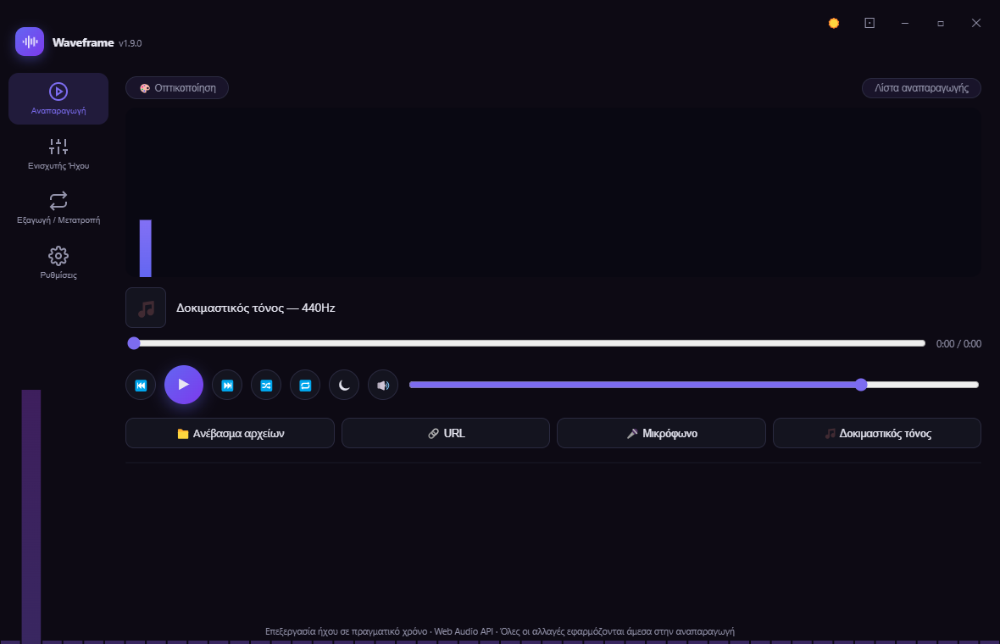
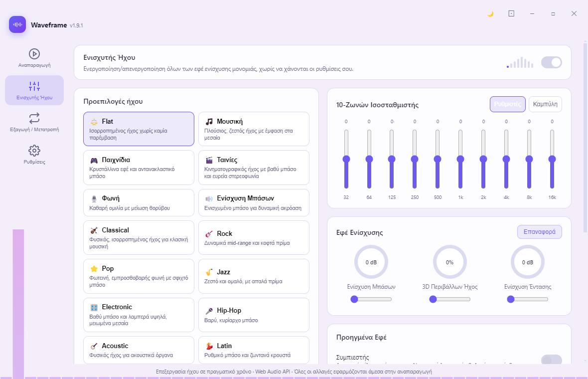
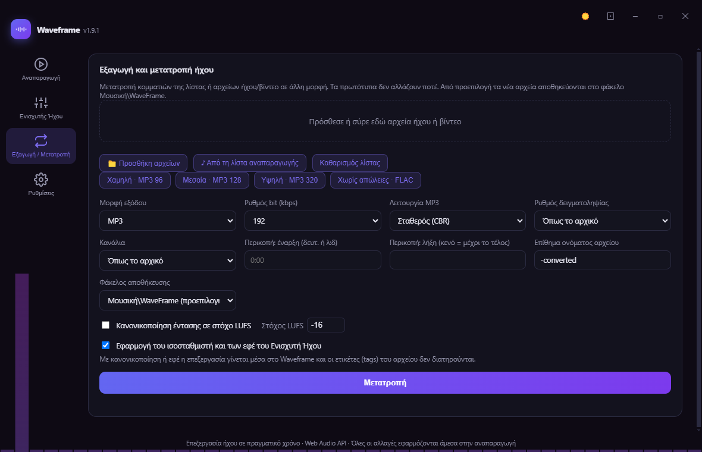
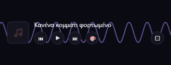

<p align="center"></p>

# Waveframe

**v1.10.0** · Windows 10/11 · MIT · [Releases](../../releases) · [The Opsis family](#η-οικογένεια-opsis--the-opsis-family)

<p align="center">
  
  
</p>
<p align="center">
  
  
</p>

Ένας δωρεάν, πραγματικός ενισχυτής ήχου και media player για Windows 10/11, χτισμένος από την αρχή με Electron και το native Web Audio API του browser — χωρίς εξωτερικό DSP engine. Φορτώνει τοπικά αρχεία, URLs, ή το μικρόφωνό σου, περνάει τον ήχο μέσα από μια πλήρη αλυσίδα ενίσχυσης σε πραγματικό χρόνο (ισοσταθμιστής, μπάσα, 3D περιβάλλων ήχος, compressor, reverb, exciter, loudness normalization, limiter), και μπορεί να εξάγει το αποτέλεσμα σε 7 μορφές αρχείου μέσω FFmpeg.

*A free, real-time audio enhancer and media player for Windows 10/11, built from scratch with Electron and the browser's native Web Audio API — no external DSP engine. See the [English section](#english) below.*

## Περιεχόμενα / Contents

- [Ελληνικά](#ελληνικά)
- [English](#english)
- [Άδεια / License](#άδεια--license)

## Ελληνικά

### Λειτουργίες

| Ενότητα | Τι κάνει |
|---|---|
| ▶️ Αναπαραγωγή | Φόρτωση αρχείου/URL/μικροφώνου/test tone, playlist με drag-drop, crossfade, album art & μεταδεδομένα, 20 visualizers |
| 🎚 Ενισχυτής Ήχου | 10-ζωνών ισοσταθμιστής (sliders ή draggable καμπύλη), Ενίσχυση Μπάσων/Έντασης, 3D Περιβάλλων Ήχος, Compressor/Reverb/Exciter, loudness normalization, master limiter — όλα με master bypass χωρίς απώλεια ρυθμίσεων |
| 💾 Εξαγωγή / Μετατροπή | Μία καρτέλα για κομμάτια της λίστας και αρχεία ήχου/βίντεο: WAV 16/24/32f, FLAC, MP3 (CBR/VBR), AAC, OGG, Opus, AIFF, ALAC, WMA· έτοιμες ποιότητες, περικοπή, ρυθμός δειγματοληψίας, κανάλια, κανονικοποίηση LUFS (BS.1770), εφαρμογή ισοσταθμιστή/εφέ, batch με ακύρωση. Αποθήκευση από προεπιλογή στο `Μουσική\WaveFrame` (ή αλλού). Το πρωτότυπο δεν αλλάζει ποτέ |
| 🎨 Εμφάνιση | 20 θέματα (skins), 10 κινούμενα φόντα, 20 visualizers, 2 διατάξεις παραθύρου (Modern/Classic), custom accent color, mini/compact always-on-top mode |
| 🌐 Γλώσσες | Πλήρης διεπαφή σε 20 γλώσσες (Ελληνικά, Αγγλικά, Γαλλικά, Γερμανικά, Ισπανικά, Ιταλικά, Πορτογαλικά, Ρωσικά, Τουρκικά, Πολωνικά, Ολλανδικά, Σουηδικά, Δανικά, Νορβηγικά, Φινλανδικά, Τσεχικά, Σλοβακικά, Ουγγρικά, Ρουμανικά, Ουκρανικά) |
| 🖥 Windows integration | SMTC (έλεγχος από lock screen/ακουστικά Bluetooth), taskbar thumbbar & jump list, συσχέτιση αρχείων ήχου, auto-launch on login, toast ειδοποιήσεις αλλαγής κομματιού |
| ♿ Προσβασιμότητα | Πλήρης πλοήγηση με πληκτρολόγιο, ορατά focus rings, σεβασμός `prefers-reduced-motion` |
| 🛡 Αξιοπιστία | Crash overlay με αρχείο καταγραφής αντί για σιωπηλή κατάρρευση, backup/restore ρυθμίσεων σε JSON (για συγχρονισμό μέσω OneDrive/Drive/Dropbox) |
| 👋 Οδηγός & οικογένεια εφαρμογών | Οδηγός καλωσορίσματος 6 σελίδων σε κάθε νέα έκδοση (major.minor) που «μαζεύεται» στο λογότυπο, παρουσίαση «Η οικογένεια Opsis» με κατάσταση εγκατάστασης και λήψη εγκαταστάτη μόνο με επιβεβαίωση και έλεγχο SHA-256, ειδοποίηση για νέα έκδοση (μία φορά ανά έκδοση, με διακόπτη) |

### Εγκατάσταση

Κατέβασε το τελευταίο `Waveframe.Setup.*.exe` (Inno Setup, εγκατάσταση χωρίς δικαιώματα διαχειριστή) από τα [Releases](../../releases) και εκτέλεσέ το — ο οδηγός εγκατάστασης υποστηρίζει επιλογή γλώσσας/φακέλου εγκατάστασης και δημιουργεί συντομεύσεις επιφάνειας εργασίας/μενού Έναρξης. Υπάρχει επίσης μια φορητή (portable) έκδοση `Waveframe-*.exe` που δεν απαιτεί εγκατάσταση.

Η εφαρμογή χρειάζεται ένα FFmpeg (LGPL build) για την εξαγωγή αρχείων· αν δεν υπάρχει ήδη στο σύστημα, το κατεβάζει μόνη της από τις Ρυθμίσεις → Dependencies με ένα κλικ.

#### Επαλήθευση λήψης (SHA-256)

Κάθε αρχείο του release συνοδεύεται από αρχείο `.sha256`. Στο PowerShell: `(Get-FileHash .\Waveframe.Setup.1.10.0.exe -Algorithm SHA256).Hash` και σύγκρινε με το περιεχόμενο του `Waveframe.Setup.1.10.0.exe.sha256`. **Απαιτήσεις:** Windows 10/11 x64· η εγκατάσταση γίνεται στο Program Files (ζητά δικαιώματα διαχειριστή). Ενημερώσεις: ειδοποίηση νέας έκδοσης με «Λήψη και εγκατάσταση» (SHA-256, σιωπηλή εγκατάσταση).

### Χτίσιμο από τον πηγαίο κώδικα

```
npm install
npm start          # εκκίνηση σε dev mode
npm run smoke-test # αυτοματοποιημένος έλεγχος εκκίνησης χωρίς σφάλματα
npm run dist        # παράγει portable + win-unpacked (Windows x64) στο release/
# Inno Setup installer (απαιτεί Inno Setup 7): ISCC.exe /DMyAppVersion=1.7.0 installerWaveframe.iss
```

### Δομή αποθετηρίου

- `main.js` / `preload.js` — Electron main process + context-isolated bridge
- `renderer/` — η ίδια η εφαρμογή (vanilla JS/HTML/CSS, χωρίς framework): `app.js` (audio engine & UI), `i18n.js` (20 γλώσσες), `backgrounds.js` (10 κινούμενα φόντα), `help.html` (ενσωματωμένος οδηγός/ιστορικό/άδεια)
- `build/` — per-language EULA αρχεία για τον installer
- `WAVEFRAME_ROADMAP.md` / `WAVEFRAME_QA_CHECKLIST.md` — ιστορικό ανάπτυξης ανά φάση και λίστα ελέγχου ποιότητας

## English

Waveframe is a free, real-time audio enhancer and media player for Windows 10/11, built from scratch with Electron and the browser's native Web Audio API — no external DSP engine. It loads local files, URLs, or your microphone, runs the audio through a full real-time enhancement chain (equalizer, bass boost, 3D surround, compressor, reverb, exciter, loudness normalization, limiter), and can export the result to 7 file formats via FFmpeg.

### Features

| Area | What it does |
|---|---|
| ▶️ Playback | File/URL/microphone/test-tone input, drag-drop playlist, crossfade, album art & metadata, 20 visualizers |
| 🎚 Audio Enhancer | 10-band equalizer (sliders or a draggable curve), Bass/Volume Boost, 3D Surround, Compressor/Reverb/Exciter, loudness normalization, master limiter — all with a master bypass that never loses your settings |
| 💾 Export / Convert | One tab for playlist tracks and audio/video files: WAV 16/24/32f, FLAC, MP3 (CBR/VBR), AAC, OGG, Opus, AIFF, ALAC, WMA; quality presets, trim, sample rate, channels, LUFS normalisation (BS.1770), optional equalizer/effects, batch with cancel. Saved to `Music\WaveFrame` by default (or any folder). The original is never changed |
| 🎨 Appearance | 20 skins, 10 animated backgrounds, 20 visualizers, 2 window layouts (Modern/Classic), custom accent color, mini/compact always-on-top mode |
| 🌐 Languages | Full interface in 20 languages (Greek, English, French, German, Spanish, Italian, Portuguese, Russian, Turkish, Polish, Dutch, Swedish, Danish, Norwegian, Finnish, Czech, Slovak, Hungarian, Romanian, Ukrainian) |
| 🖥 Windows integration | SMTC (lock screen / Bluetooth headset controls), taskbar thumbbar & jump list, audio file associations, auto-launch on login, track-change toast notifications |
| ♿ Accessibility | Full keyboard navigation, visible focus rings, respects `prefers-reduced-motion` |
| 🛡 Reliability | Crash overlay with a log file instead of a silent failure, JSON backup/restore of all settings (for syncing via OneDrive/Drive/Dropbox) |
| 👋 Guide & app family | 6-page welcome guide on every new major.minor version that shrinks into the header logo, “The Opsis family” showcase with install state and an installer download only after a confirmation and SHA-256 check, new-version notification (once per version, can be switched off) |

### Installation

Download the latest `Waveframe.Setup.*.exe` (Inno Setup, per-user, no admin rights) from [Releases](../../releases) and run it — the installer wizard supports choosing a language/install folder and creates desktop/Start Menu shortcuts. A portable `Waveframe-*.exe` build that needs no installation is also provided.

The app needs an FFmpeg (LGPL build) for exporting; if one isn't already on your system, it can download it itself from Settings → Dependencies with one click.

#### Verify your download (SHA-256)

Every release file has a matching `.sha256` file. In PowerShell: `(Get-FileHash .\Waveframe.Setup.1.10.0.exe -Algorithm SHA256).Hash` and compare it with the contents of `Waveframe.Setup.1.10.0.exe.sha256`. **Requirements:** Windows 10/11 x64; installs to Program Files (asks for administrator rights). Updates: new-version notification with "Download and install" (SHA-256, silent install).

### Building from source

```
npm install
npm start          # launch in dev mode
npm run smoke-test # automated startup/crash check
npm run dist        # produces a portable build + NSIS installer (Windows x64) in release/
```

### Repository layout

- `main.js` / `preload.js` — Electron main process + context-isolated bridge
- `renderer/` — the app itself (vanilla JS/HTML/CSS, no framework): `app.js` (audio engine & UI), `i18n.js` (20 languages), `backgrounds.js` (10 animated backgrounds), `help.html` (built-in guide/changelog/license)
- `build/` — per-language EULA files for the installer
- `WAVEFRAME_ROADMAP.md` / `WAVEFRAME_QA_CHECKLIST.md` — phase-by-phase development history and QA checklist

## Η οικογένεια Opsis / The Opsis family

Από το Waveframe (Ρυθμίσεις → Σχετικά → «Η οικογένεια Opsis») βλέπεις τις άλλες εφαρμογές του ίδιου δημιουργού: [Opsis](https://github.com/giorstergiopoulos-design/Opsis), [Opsis News Crawler](https://github.com/giorstergiopoulos-design/OpsisNewsCrawler), [Opsis Appearance](https://github.com/giorstergiopoulos-design/OpsisAppearance), [GearWin](https://github.com/giorstergiopoulos-design/GearWin), [Opsis Media Player Pro](https://github.com/giorstergiopoulos-design/OpsisMediaPlayerPro), [Kombos](https://github.com/giorstergiopoulos-design/Kombos).

*From Waveframe (Settings → About → "The Opsis family") you can browse the author's other apps, listed above.*

## Απόρρητο / Privacy

**Ελληνικά:** Το Waveframe δεν στέλνει τηλεμετρία. Οι μόνες συνδέσεις στο διαδίκτυο είναι αιτήματα GET προς το GitHub: (1) έλεγχος του τελευταίου release (`api.github.com`, το πολύ μία φορά την ημέρα, με ETag), που απενεργοποιείται από Ρυθμίσεις → Ειδοποίηση για νέες εκδόσεις· (2) η λίστα εφαρμογών της οικογένειας (`raw.githubusercontent.com`, το πολύ μία φορά την ημέρα, με ενσωματωμένο αντίγραφο εφεδρείας) και τα releases των εφαρμογών όταν ανοίξεις το παράθυρο «Η οικογένεια Opsis»· (3) λήψη εγκαταστάτη μόνο αν το επιβεβαιώσεις. Η λήψη επαληθεύεται με SHA-256 και ποτέ δεν εκτελείται αυτόματα. Δεν γίνεται αυτόματη εγκατάσταση ενημερώσεων.

**English:** Waveframe sends no telemetry. The only network requests are GETs to GitHub: (1) the latest-release check (`api.github.com`, at most once a day, using ETag), which you can switch off in Settings → Notify about new versions; (2) the app-family list (`raw.githubusercontent.com`, at most once a day, with a built-in fallback copy) and the apps' releases when you open “The Opsis family”; (3) an installer download only if you confirm it. Downloads are verified with SHA-256 and never run automatically. Updates are never installed automatically.

## Τρίτα μέρη / Third-party

- **FFmpeg** (LGPL-2.1+/3, build της BtbN «win64-lgpl»): το Waveframe **δεν** το συμπεριλαμβάνει στον installer. Χρησιμοποιεί ffmpeg που υπάρχει ήδη στο PATH, αλλιώς το κατεβάζει μία φορά **μετά από επιβεβαίωσή σου** από https://github.com/BtbN/FFmpeg-Builds (έλεγχος SHA-256 από το release). Πηγαίος κώδικας: https://ffmpeg.org και το αποθετήριο της BtbN. Αν έχεις δικό σου ffmpeg στο PATH (π.χ. GPL build), ισχύει η άδειά του.
- **FFmpeg** (LGPL build by BtbN): **not** bundled in the installer. Waveframe uses an ffmpeg already on PATH, otherwise downloads the LGPL build once **after you confirm** from https://github.com/BtbN/FFmpeg-Builds (SHA-256 checked against the release). Source: https://ffmpeg.org and the BtbN repository. If you put your own ffmpeg on PATH (e.g. a GPL build) its own licence applies.
- Electron (MIT), music-metadata (MIT), adm-zip (MIT).

## Άδεια / License

Το Waveframe διανέμεται με την **άδεια MIT** (βλ. [LICENSE](LICENSE)). Τα πλήρη κείμενα των αδειών των τρίτων στοιχείων (Electron/Chromium, music-metadata, adm-zip: MIT· FFmpeg: LGPL v3 με παραπομπή στην GPL v3) βρίσκονται στο φάκελο [licenses](licenses) και στο παράθυρο Βοήθεια → Άδεια χρήσης.

*Waveframe is distributed under the **MIT License** (see [LICENSE](LICENSE)). The full texts of the third-party licenses (Electron/Chromium, music-metadata, adm-zip: MIT; FFmpeg: LGPL v3, which incorporates the GPL v3 by reference) are in the [licenses](licenses) folder and in Help → License.*

**Το λογισμικό παρέχεται "ΩΣ ΕΧΕΙ", χωρίς καμία εγγύηση. / Provided "AS IS", without warranty of any kind.**
